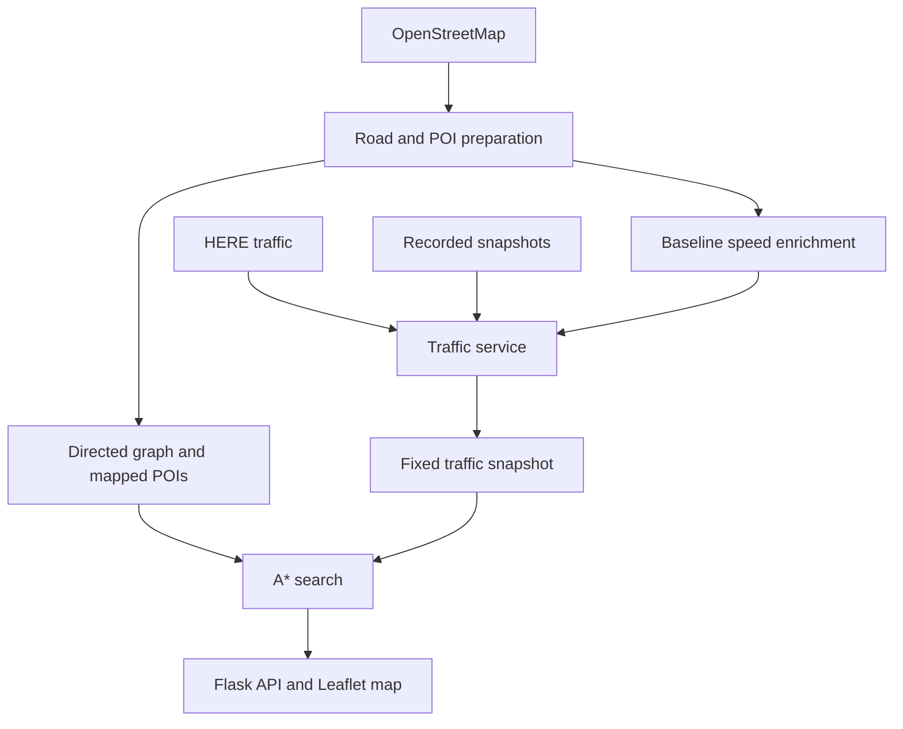

# HCMC Traffic A*

Traffic-aware route planning between points of interest in Ho Chi Minh City using **A***, **OpenStreetMap**, and **traffic-speed snapshots**.

A project for **Introduction to Artificial Intelligence — CO3061**, Homework 1, at **Ho Chi Minh City University of Technology (HCMUT), VNU-HCM**.

## Overview

The application finds routes that minimize estimated travel time on a directed road network. It combines OSM road and POI data, traffic processing, heuristic search, and an interactive map.

Traffic is selected through three modes:

- **LIVE:** HERE traffic observations, supplemented with fallback speeds.
- **REPLAY:** a previously recorded complete snapshot.
- **FALLBACK:** modeled speeds based on road attributes and time of day.

Each route query uses one fixed snapshot throughout the search.

### Current dataset

| Item | Count |
|---|---:|
| Road nodes | 279,028 |
| Directed edges | 546,742 |
| Validated POIs | 158 |
| POI categories | 10 |

The study area extends approximately 15 km in each direction from **10.7769° N, 106.7009° E**. It does not cover the complete administrative area of Ho Chi Minh City.

## Features

- Directed graph with one-way information and parallel-edge identities.
- Intermediate OSM nodes retained for POI mapping.
- Connectivity-constrained POI mapping, including HCMUT CS1.
- LIVE → REPLAY → FALLBACK traffic-source selection.
- Travel-time A* search and Dijkstra comparison.
- Interactive Leaflet map with category filters and layer controls.
- Route distance, estimated travel time, and traffic-source information.

## Quick Start

### 1. Clone the repository

```bash
git clone https://github.com/wiliamvux2102/HCMC-Traffic-AStar.git
cd HCMC-Traffic-AStar
```

Run all subsequent commands from the repository root.

### 2. Create a Python environment

The documented evaluation used **Python 3.12.14 on Windows 11**.

```bash
python -m venv .venv
```

Activate on Windows PowerShell:

```powershell
.\.venv\Scripts\Activate.ps1
```

Or on macOS/Linux:

```bash
source .venv/bin/activate
```

Install dependencies:

```bash
python -m pip install --upgrade pip
python -m pip install -r requirements.txt
```

### 3. Prepare the datasets

If the current processed datasets are already available, reuse them. Otherwise, run:

```bash
python src/data/run_pipeline.py
```

This downloads OSM data and produces the road and POI tables. Downloads may take time, and updated OSM data can produce different counts.

The application requires:

```text
data/processed/nodes.csv
data/processed/edges.csv
data/processed/poi_final.csv
data/processed/edges_enriched.csv
```

To create or regenerate `edges_enriched.csv`:

```bash
python -c "from src.traffic.baseline import enrich_edges; enrich_edges('data/processed/edges.csv', 'data/processed/edges_enriched.csv')"
```

Baseline enrichment derives modeled free-flow speeds from parsed speed limits or road-class defaults.

**Road data, enriched edges, and replay snapshots must belong to compatible graph versions.** Regenerate enrichment after changing the graph.

### 4. Configure optional LIVE traffic

Set the HERE API key in the shell used to launch the application.

Windows PowerShell:

```powershell
$env:HERE_API_KEY = "your_here_api_key"
```

macOS/Linux:

```bash
export HERE_API_KEY="your_here_api_key"
```

Do not commit credentials.

If LIVE acquisition fails, the traffic service attempts REPLAY and then FALLBACK. FALLBACK still requires a valid enriched-edge dataset.

### 5. Start the application

```bash
python -m app.app
```

Open **http://localhost:5000**. The root page redirects to `/viz`.

The supplied entry point enables Flask debug mode and is intended for local development and demonstrations.

## Usage

1. Select a start POI and a different destination.
2. Click **Find Route**.
3. Inspect the route, distance, and estimated travel time.
4. Check the traffic mode and snapshot timestamp.

Route segments are colored according to snapshot speeds:

- **Blue:** at least 50% of free-flow speed and at least 20 km/h.
- **Red:** below either threshold.

REPLAY and FALLBACK colors do not necessarily describe current live conditions. A LIVE snapshot may also contain fallback speeds on uncovered roads.

Use category filters and layer controls to explore the map. Sampling displayed nodes or edges does not reduce the routing graph.

## Architecture



| Directory | Responsibility |
|---|---|
| `src/data/` | OSM acquisition, graph export, POI selection and validation |
| `src/graph/` | Graph representation and loading |
| `src/traffic/` | Baseline enrichment, traffic matching, providers and snapshots |
| `src/routing/` | A*, heuristic, costs and Dijkstra |
| `src/evaluation/` | Heuristic verification and benchmarking |
| `src/visualization/` | Map data and route visualization |
| `app/` | Flask application and frontend |
| `tests/` | Automated tests |

## Routing evaluation

Install the test dependencies and run from the repository root:

```bash
python experiments/run_tests.py
python experiments/evaluate_routing.py
```

The results are stored in `experiments/results/evaluation/`.
They retain costs, search measurements and heuristic checks without duplicating
complete route paths. See [the experiment documentation](experiments/results/README.md)
for the dataset requirements, measurement method and output options.

### Data and routing contracts

Edges retain their full `(source, target, edge_key)` identity. POIs are mapped to their nearest eligible node within the largest strongly connected component using a unit-sphere KD-tree.

Mappings over 500 m and one reviewed duplicate are removed. All 158 final POI nodes are mutually reachable in the stored directed graph.

Travel-time cost and heuristic are:

```text
cost(e) = 3.6 × distance_m(e) / speed_kph(e)
h(n)    = 3.6 × HaversineDistance(n, goal) / V_bound
```

`V_bound` is the maximum speed in the complete snapshot. A* performs no traffic API calls during search.

## Testing

Run the test suite:

```bash
python -m unittest discover -s tests -v
```

Run routing tests separately:

```bash
python -m unittest tests.test_routing -v
```

## Limitations

- Speeds remain fixed during each query; this is snapshot-based routing.
- POI-to-road access is approximated. Route totals exclude travel from the POI centroid to its mapped node.
- LIVE coverage is partial; fallback speeds are estimates.
- Dependency versions are not fully pinned.
- The report identifies outdated diagnostic scripts and a legacy CLI import issue.
- The Flask debug server is not a production deployment configuration.

## Team

**Advisor:** Ph.D Nguyễn Quốc Minh

| Member | Student ID |
|---|---|
| Phạm Trường Chính | 2410407 |
| Vũ Hoàng Hải | 2410917 |
| Trần Quang Huy | 2411278 |
| Nguyễn Ngọc Thạch | 2413218 |

Contributions cover data preparation, traffic processing, routing and evaluation, and visualization.

## Credits and License

Built with OpenStreetMap, OSMnx, NetworkX, pandas, GeoPandas, SciPy, Flask, Leaflet, and HERE traffic services.

Map data attribution: **© OpenStreetMap contributors**.
